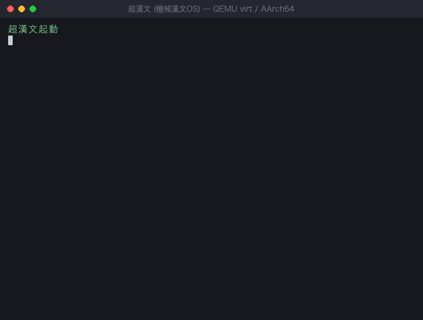

# 超漢文 OS — ChoKanbun OS

**機械漢文でカーネル内部まで記述する ARM64 ネイティブ OS。**

> 世界安寧



QEMU `virt` / AArch64 で動く研究用 OS。カーネルも、その上で動く漢文シェルも機械漢文で書いている。
機械漢文は独立したシステムプログラミング言語で、LLVM IR 経由で ARM64 機械語へコンパイルする。

## 現状

| マイルストーン | 内容 | 状態 |
|---|---|---|
| M0 | コンパイラ（字句・構文・型検査・LLVM IR 出力） | 達成 |
| M1 | QEMU で機械漢文から「世界安寧」を UART に出力 | 達成（GDB 手順は未整備） |
| M2 | カーネル基盤: 例外・MMU・物理ページ・タイマー・割込 | 達成 |
| M3 | 行程: EL0・漢令（SVC）・スケジューラ・アドレス空間・プリエンプション | 達成 |
| M4 | 典籍（RAMFS/VFS）と漢文シェル（殻） | 達成（最小版） |
| M5 | POSIX 互換サブセット（exec/wait/pipe/fork） | 未着手 |
| M6 | 機械漢文製ブートローダー | 未着手 |
| M7 | セルフホスティング | 未着手 |

`make test` は 134 ケースすべて PASS（IR 生成 → AArch64 オブジェクト → ELF リンク → QEMU 実行まで）。
詳しい進捗と次の一手は [ロードマップ](docs/roadmap.md)、実装の中身は [実装メモ](docs/implementation-notes.md)。

## クイックスタート

### 必要なもの

macOS（Homebrew）を想定している。

```sh
brew install llvm lld qemu
```

LLVM ツールは既定で `/opt/homebrew/opt/llvm/bin` と `/opt/homebrew/opt/lld/bin` を参照する。
場所が違うときは `LLVM_BIN` / `LLD_BIN` で上書きする。

### ビルドとテスト

```sh
make          # コンパイラ (chokanbun) をビルド
make test     # 全テストを実行（カーネル tests/output/kernel.elf も作る）
make clean
```

### QEMU で動かす

```sh
make test
qemu-system-aarch64 -M virt,gic-version=2 -cpu cortex-a57 -nographic \
  -serial mon:stdio -kernel tests/output/kernel.elf
```

- 起動ログが流れたら、**先に 1 行**（例: `KANBUN`）入力して Enter を押す。起動時の読込テストがこの 1 行を使う。
- そのあと `殻> ` が出て、殻の命令を入力できる。
- QEMU の終了は `Ctrl-A` のあと `X`。

```
殻> 響 超漢文起動
殻響:超漢文起動
殻> 讀 詩経
殻讀:關關雎鳩、在河之洲
殻> 目
殻目:史記
殻目:詩経
殻> 書 筆記 天地玄黄
殻書 0x000000000000000c
殻> 助
```

殻の命令は `響`・`讀`・`目`・`書`・`削`・`助`・`終` と、外部命令（`問安`・`數`。`user/` の漢像）。書式とエラーの読み方は
[殻のコマンド一覧](docs/shell-commands.md)。ファイルは RAM 上だけで、再起動すると消える。

## ソース構成

| パス | 内容 |
|---|---|
| `src/` | コンパイラ（字句解析・構文解析・型検査・LLVM IR 生成） |
| `kernel/` | 漢極（カーネル）。本体 `kernel.txt` は機械漢文、入口は暫定アセンブリ（`boot.S`・`vectors.S`・`sysreg.S`・`el0.S`）。典籍（VFS/RAMFS）は `kernel/vfs/` |
| `user/` | 外部命令（行程として起動される機械漢文のプログラム）。`hello.txt`（問安）、`count.txt`（數）、`lib.txt`（漢令のラッパ）、`crt0.S`・`user.lds`（漢像のヘッダと入口） |
| `tools/` | ビルド補助。`kernel-expand.sh`（`註 @取込` の展開）、`mkimage.sh`（外部命令を漢像にする）、`gen-images.sh`（漢像をカーネルへ埋め込む） |
| `boot/` | Phase 0 の起動スタブと C 版 UART ドライバ（参照用） |
| `tests/` | テスト（`run_tests.sh`）と機械漢文のサンプル |
| `docs/` | 設計文書 |

## テストの内容

`make test` は `tests/run_tests.sh` を呼び、次を検証する。

| 区分 | 内容 |
|---|---|
| `hello` / `uart` / `uart_mmio` | 機械漢文 → LLVM IR → AArch64 オブジェクト → ELF リンク（`uart_mmio` は機械漢文だけで書いた PL011 ドライバ） |
| `kernel` | 漢極のオブジェクト・ELF リンク、例外ベクタ表の 2 KiB 整列 |
| `type_error` | 型不一致の診断（`E00xx`）が出ること |
| `qemu` | QEMU 上で「世界安寧」が出ること |
| `kernel qemu` | 超漢文起動、例外捕獲、MMU、物理ページ、タイマー割込、EL0 行程・漢令・境界検査、プリエンプション、待機と起床、デマンドページング、UART 入力、典籍、殻の各命令 |

## 設計文書

- [全体構成](docs/architecture.md)
- [機械漢文言語仕様草案](docs/language-spec.md)
- [AArch64 ABI・ブート方針・漢令一覧](docs/abi-aarch64.md)
- [OS 詳細設計 v0.2](docs/detailed-design-v0.2.md)
- [POSIX 互換方針](docs/posix-compat.md)
- [行程・外部命令・パイプ・exec/fork の設計](docs/design-process-exec.md)
- [篇藏 v0.1（ファイル体系）の設計](docs/design-pianfs.md)
- [殻のコマンド一覧](docs/shell-commands.md)
- [実装メモ](docs/implementation-notes.md)
- [ロードマップ](docs/roadmap.md)

## 目的と開発方針

- AArch64（ARMv8-A）を対象とする独立した研究用 OS を開発する。
- カーネル、システムコール、メモリ管理、プロセス管理、ドライバ、ユーザーランドを機械漢文で記述する。
- POSIX 互換性は段階的に実装する（適合は主張しない）。
- 最初の実行環境は QEMU `virt` / AArch64。
- ブート初期化などは当面、最小限の AArch64 アセンブリを許容し、後に低水準の機械漢文構文へ移行する。
- コンパイラのブートストラップ実装には既存言語を許容する。カーネル本体は機械漢文を原則とする。
- `machine-kanbun` とは独立して仕様・実装・Issue を管理する。
